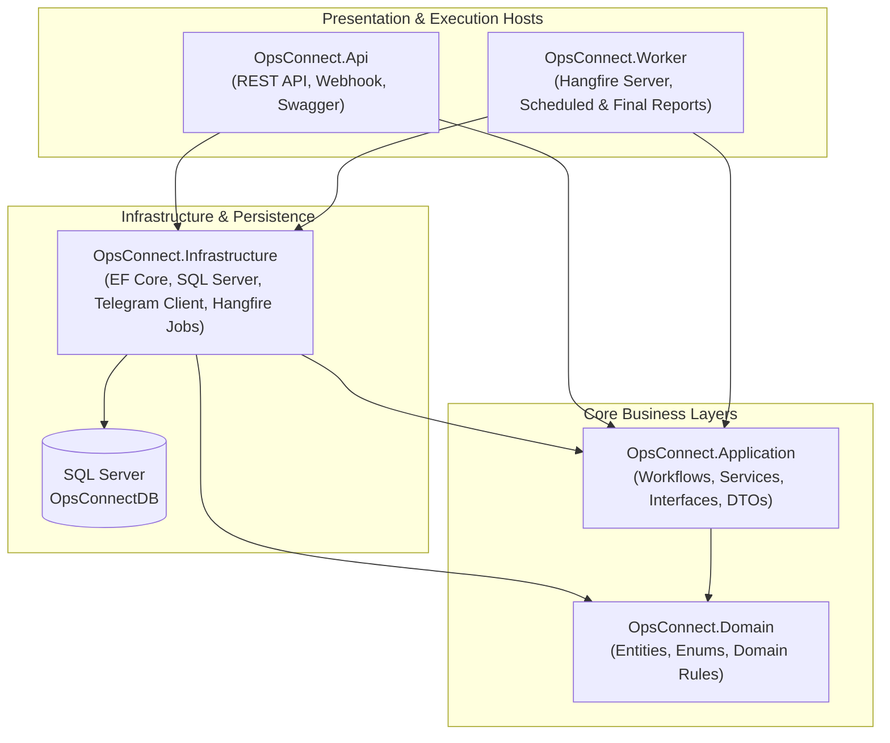

# OpsConnect — Architecture Overview

## 1. Architectural Style: Modular Monolith

OpsConnect uses a **Clean / Layered Modular Monolith** architecture. This pattern provides strong separation of concerns and high testability without the operational overhead of distributed microservices.

---

## 2. Project Responsibilities & Dependency Rules

| Project | Role | Allowed Project References |
|---|---|---|
| `OpsConnect.Domain` | Enterprise entities, enums, domain invariants, audit abstractions. Zero external infrastructure dependencies. | *None* |
| `OpsConnect.Application` | Application service contracts, business workflow orchestration, parser logic, reporting calculation contracts. | `OpsConnect.Domain` |
| `OpsConnect.Infrastructure` | `OpsConnectDbContext`, EF Core entity configurations, migrations, SQL Server repositories, Telegram HTTP integration, Hangfire scheduling adapters. | `OpsConnect.Application`, `OpsConnect.Domain` |
| `OpsConnect.Api` | HTTP controllers, Telegram webhook endpoint, authentication/authorisation middleware, OpenAPI/Swagger configuration. | `OpsConnect.Application`, `OpsConnect.Infrastructure` |
| `OpsConnect.Worker` | Background host running Hangfire server for scheduled activity reports, immediate completion reports, and delivery retry jobs. | `OpsConnect.Application`, `OpsConnect.Infrastructure` |

> **Rule**: Neither `OpsConnect.Api` nor `OpsConnect.Worker` may duplicate business rules. Both invoke shared application services registered via Dependency Injection.

---

## 3. Core Functional Modules

Within `Domain` and `Application`, code is vertically grouped by functional module:

1. **Organisation (`org`)**: Manages `Zone → State → Region → Branch` hierarchy, active status, validation, and historical hierarchy mappings (`OrganisationMappingHistory`).
2. **Activities (`activity`)**: Manages generic `ActivityMaster` records, daily branch `ActivityStatus` snapshots, immutable `ActivityHistory` audit trails, and single-use administrator `StatusReopenPermission` records.
3. **Telegram (`telegram`)**: Manages authorised source and destination `TelegramGroups` and records every inbound webhook payload in `TelegramMessageLog` with a composite unique key `(TelegramChatId, TelegramMessageId)`.
4. **Reporting (`reporting`)**: Manages daily `ReportingCycle` state (including automatic completion stop and reopening reactivation), scheduled `ReportingSlot` execution tracking, generated `SummaryLog` snapshots, and per-destination `ReportDeliveryLog` state machines.
5. **Administration (`admin`)**: Manages `UserMaster`, `RoleMaster`, `UserRoleMapping`, system settings, `ActivityReportingConfiguration` (start time, end time, interval, time zone, effective dates), and `ConfigurationHistory`.

---

## 4. Concurrency, Idempotency, and Time Zone Design

- **UTC Storage vs. Business Time Zone**:
  - Every system timestamp (`CreatedAtUtc`, `UpdatedAtUtc`, `ReceivedAtUtc`, `GeneratedAtUtc`, `DeliveredAtUtc`) is stored in **UTC**.
  - Operational reporting cycles and reporting dates (`ReportingDate`) are evaluated in the activity's configured time zone (default `Asia/Kolkata`).
- **Optimistic Concurrency & Database Constraints**:
  - Critical mutable records (`ActivityStatus`, `StatusReopenPermission`, `ReportingCycle`, `ReportingSlot`) include SQL Server `rowversion` (`RowVersion`) concurrency tokens alongside unique database indexes to prevent race conditions during simultaneous Telegram updates or worker executions.
